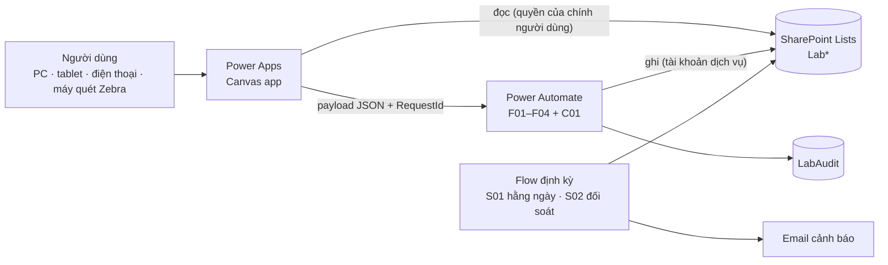
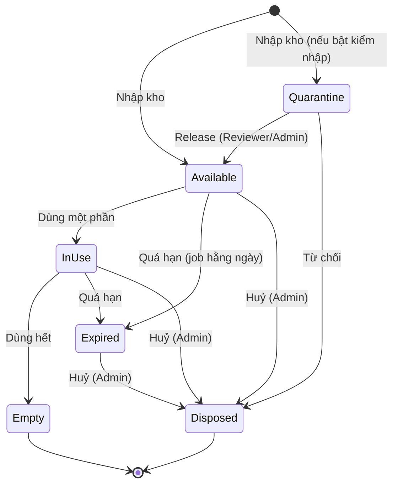
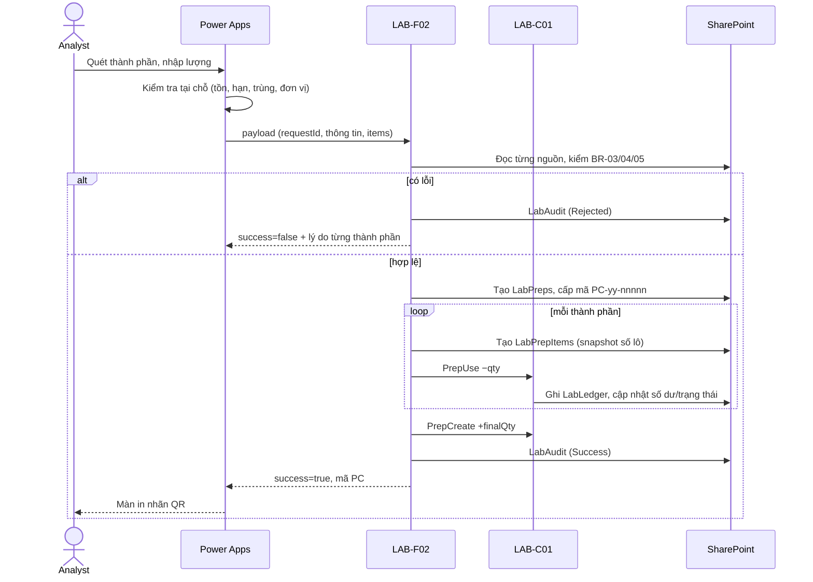

# 01 — Thiết kế tổng thể

## 1. Mục tiêu và phạm vi

Ứng dụng giúp người làm trong phòng lab **đăng ký, theo dõi và truy xuất hoá chất** thay cho sổ tay/Excel. Dữ liệu nằm trong SharePoint Lists, giao diện bằng Power Apps (Canvas), nghiệp vụ và kiểm soát chạy bằng Power Automate.

**Trong phạm vi giai đoạn 1 (đã thiết kế):** 5 yêu cầu anh nêu + các thành phần bắt buộc để chúng hoạt động đáng tin cậy (phân quyền, sổ cái, nhật ký kiểm toán, cảnh báo hạn dùng và sắp hết theo %, in nhãn có QR + mã vạch).

**Gợi ý mở rộng** (chuyển vị trí, hạn sau mở nắp, nạp tồn đầu kỳ, kiểm kê…): xem mục 8 ở cuối tài liệu này.

**Chưa làm (giai đoạn 2):** duyệt nhập kho bằng Approvals, thông báo qua Teams, PDF nhãn tự động, xuất báo cáo truy xuất PDF/Excel, upload COA từ app, mã vạch 1D, ảnh GHS trên nhãn, quản lý chất đặc biệt, đặt hàng/mua sắm.

## 2. Yêu cầu → tính năng

| # | Yêu cầu của anh | Tính năng | Màn hình | List | Flow |
|---|---|---|---|---|---|
| 1 | Đăng ký hoá chất đầu vào | Nhập theo danh mục, số lô NSX, hạn dùng, lượng, vị trí, COA; **mỗi chai một mã** `IN-yy-nnnnn`; hỗ trợ nhập nhiều chai cùng lô; kiểm tra hạn dùng, đơn vị, trùng | `scrLotRegister`, `scrLabel` | `LabCatalog`, `LabLocations`, `LabLots`, `LabLedger` | F01 |
| 2 | Đăng ký pha chế hoá chất | Wizard 3 bước; thành phần là chai hoặc dung dịch pha khác; kiểm tra tồn/hạn ngay khi nhập; tự trừ tồn; mã `PC-yy-nnnnn`; hạn dùng không vượt hạn thành phần; duyệt 4 mắt | `scrPrepRegister`, `scrLabel` | `LabPreps`, `LabPrepItems`, `LabLedger` | F02, C01, F04 |
| 3 | Theo dõi lượng còn lại | Số dư theo sổ cái; thanh còn lại, trạng thái tự động (Sẵn sàng/Đang dùng/Hết/Hết hạn); lọc, gộp theo hoá chất; cảnh báo **sắp hết theo % (đặt riêng từng hoá chất hoặc dùng mặc định chung)** & sắp hết hạn; lịch sử từng chai | `scrHome`, `scrInventory`, `scrDetail`, `scrUsage` | `LabLedger`, `LabLots`, `LabPreps` | F03, C01, S01, S02 |
| 4 | Truy xuất biên bản thử nghiệm qua mã hoá chất pha | Gắn hoá chất vào **số biên bản** khi dùng; tra ngược từ mã pha → công thức → chai/lô/COA; tra xuôi từ chai → dung dịch → biên bản (phục vụ thu hồi theo lô) | `scrUsage`, `scrTrace` | `LabTestUsage`, `LabPrepItems` | F03 |
| 5 | QR code / mã vạch để quét | Nhãn mỗi chai/dung dịch có **QR + mã vạch Code 39**; quét bằng **máy Zebra cầm tay (hoạt động như bàn phím, không cần camera)** hoặc camera điện thoại; hiểu cả mã trơn lẫn link; mở thẳng chi tiết | `scrScan`, `scrLabel` | — | — |

## 3. Giả định đã dùng (cần anh xác nhận — xem [05 §7](05-Bao-mat-va-Kiem-thu.md))

1. **Biên bản thử nghiệm** (xem mục 3a) đã có sẵn (ở thư viện SharePoint hoặc nơi khác) và người dùng nhập **số biên bản + link**; app không tạo biên bản.
2. Quản lý theo **chai/đơn vị vật lý**, mỗi chai một nhãn.
3. Số lượng lưu theo **đơn vị gốc** (g, mL, pcs); app lo quy đổi khi nhập.
4. Thiết bị: máy tính + **máy quét Zebra cầm tay** (giả định kiểu USB/Bluetooth hoạt động như bàn phím, chưa biết model, 1D hay 2D); điện thoại/máy tính bảng chỉ là phụ.
5. Quy mô phòng lab vừa (vài nghìn chai/năm, vài chục người dùng).
6. Có thể xin tài khoản dịch vụ để làm chủ flow và môi trường hỗ trợ Solution.
7. Ngôn ngữ giao diện: tiếng Việt.

## 3a. Thuật ngữ cần thống nhất

| Thuật ngữ | Nghĩa trong tài liệu này |
|---|---|
| **Biên bản thử nghiệm** | Tài liệu ghi lại **một lần thử nghiệm trên một mẫu** (còn gọi báo cáo / phiếu kết quả thử nghiệm, *test report*): mẫu nào, chỉ tiêu gì, phương pháp nào, ngày nào, ai làm, **dùng thiết bị và hoá chất/dung dịch nào**, kết quả ra sao, ai duyệt. App chỉ lưu **số biên bản** (và link tới file nếu có) để nối biên bản với các hoá chất đã dùng. |
| Vì sao phải nối | Khi một dung dịch pha hoặc một lô hoá chất có vấn đề (pha sai, nhà cung cấp thu hồi lô, dùng quá hạn), phòng lab phải tìm ra **mọi biên bản đã dùng nó** để đánh giá ảnh hưởng đến kết quả đã phát hành. Ngược lại, khi rà soát một biên bản, phải chứng minh được hoá chất trong đó còn hạn, được pha và duyệt đúng. Phòng lab theo ISO/IEC 17025 thường cần chứng minh được điều này. |
| **COA** (Certificate of Analysis) | Giấy chứng nhận chất lượng của **nhà cung cấp** đi kèm *chai hoá chất*. Không phải biên bản thử nghiệm. App lưu link COA ở từng chai. |
| **Chai / lô** | *Chai* = một đơn vị vật lý có nhãn QR riêng (`IN-yy-nnnnn`). *Lô* = số lô của nhà sản xuất, nhiều chai có thể cùng lô. |
| **Dung dịch pha** | Hoá chất do phòng lab tự pha từ các chai hoặc từ dung dịch pha khác (`PC-yy-nnnnn`). |
| **Lượng tồn chuẩn** | Lượng của một hoá chất mà phòng lab muốn có khi kho đầy đủ; là mốc 100% để tính % còn lại và cảnh báo cần mua thêm. |

## 4. Kiến trúc

Điểm mấu chốt: **người dùng chỉ đọc, flow mới ghi**. Chi tiết quyền ở [05](05-Bao-mat-va-Kiem-thu.md); dữ liệu ở [02](02-Mo-hinh-du-lieu.md); flow ở [03](03-Power-Automate.md); màn hình/công thức ở [04](04-Power-Apps.md).

## 5. Luồng nghiệp vụ

### 5.1 Vòng đời chai đầu vào

Dung dịch pha có vòng đời tương tự (không có `Quarantine`) cộng thêm trạng thái duyệt `Pending → Approved/Rejected`. Đối tượng ở trạng thái `Empty`, `Expired`, `Disposed` **vẫn tra cứu và truy xuất được** — chỉ không dùng thêm được.

### 5.2 Đăng ký pha chế (luồng quan trọng nhất)

### 5.3 Gắn biên bản và truy xuất

1. Khi làm thử nghiệm, người dùng mở **Ghi nhận sử dụng**, nhập số biên bản, quét các mã hoá chất đã dùng và lượng → F03 trừ tồn và ghi `LabTestUsage`.
2. Muốn truy xuất: nhập/quét mã dung dịch pha → app dựng **cây nguồn gốc** (đến chai, số lô NSX, COA) và **danh sách biên bản** đã dùng dung dịch đó.
3. Truy xuôi: quét mã chai/lô → thấy mọi dung dịch hậu duệ và biên bản liên quan (tối đa 3 cấp) — dùng khi nhà cung cấp thông báo lô có vấn đề.

### 5.4 Vòng đời mã QR

1. Mã sinh ra khi **lưu** (không phải khi mở biểu mẫu) → luôn duy nhất.
2. App chuyển thẳng sang màn in nhãn; nhãn gồm QR + mã + tên + số lô/nồng độ + hạn dùng + vị trí.
3. Quét: camera app, súng quét hoặc (nếu bật DeepLink) camera điện thoại thường.
4. Nhãn hỏng/mất: in lại từ `scrDetail`, mã không đổi.

## 6. Quyết định thiết kế chính

| # | Quyết định | Lý do | Đánh đổi |
|---|---|---|---|
| D1 | Sổ cái (`LabLedger`) là nguồn sự thật, số dư là cache | Kiểm toán được, tự sửa lệch, không mất dữ liệu khi có lỗi | Thêm một list và một bước đối soát |
| D2 | Mọi thao tác ghi đi qua flow | Kiểm tra quyền và nghiệp vụ phía server; người dùng không cần quyền ghi; ghi nhật ký đồng nhất | Phụ thuộc Power Automate; độ trễ vài giây mỗi lần lưu |
| D3 | Quan hệ bằng ID số + mã snapshot, không dùng Lookup column | Tránh giới hạn lookup/view và cảnh báo delegation | Toàn vẹn tham chiếu do flow bảo đảm |
| D4 | Mã `yy-nnnnn` lấy từ SharePoint `ID` | Không có race condition, không cần bảng bộ đếm, duy nhất tuyệt đối | Có thể có khoảng trống số; số không reset theo năm |
| D5 | Một chai một mã | Theo dõi còn lại chính xác theo từng chai | Nhập 20 chai tạo 20 dòng (đã tối ưu bằng chạy song song) |
| D6 | QR mặc định chỉ chứa mã | Mọi đầu đọc hiểu; không lộ thông tin; DeepLink bật sau | Điện thoại thường quét ra chữ, không mở app |
| D7 | Canvas app: Modern controls + named formulas + component | Giao diện hiện đại, dễ bảo trì, truy cập tốt | Một số control (gallery, barcode scanner) vẫn là classic |
| D8 | SharePoint List (theo yêu cầu) thay vì Dataverse | Đúng chỉ định, chi phí và quản trị đơn giản | Không có transaction/khoá bản ghi thật sự → bù bằng ledger + đối soát (R-01); nếu mở rộng nên cân nhắc Dataverse |
| D9 | Không xoá; sửa bằng bút toán đảo có lý do | Yêu cầu kiểm toán/hồ sơ phòng lab | Dữ liệu tăng dần → có kế hoạch lưu trữ |
| D10 | Quét bằng máy Zebra cầm tay qua ô nhập văn bản (kiểu bàn phím) + Timer; camera chỉ là phụ | Máy cầm tay không có camera, không gửi hình; control camera của Power Apps không chạy trong trình duyệt | Ô nhập phải luôn giữ focus; máy 1D không đọc được QR → nhãn in thêm Code 39 |
| D11 | Cảnh báo sắp hết theo % của *lượng tồn chuẩn*; mặc định 20%, mỗi hoá chất có thể đặt riêng | Một con số mặc định dùng ngay được, ai cần thì tinh chỉnh; mốc 100% tự lấy từ tồn cao nhất đã đạt nếu chưa đặt | % so với "tồn chuẩn" chứ không phải so với từng chai — cần Admin đặt tồn chuẩn cho hoá chất quan trọng |

## 7. Lộ trình triển khai

| Giai đoạn | Nội dung | Kết quả kiểm tra |
|---|---|---|
| 0 | Chốt câu hỏi mở ([05 §7](05-Bao-mat-va-Kiem-thu.md)), xin môi trường, tài khoản dịch vụ, nhóm bảo mật | Quyết định bằng văn bản |
| 1 | Chạy `New-LabChemLists.ps1 -SeedData -AdminEmail …`; nạp danh mục, vị trí, vai trò | Lists đúng schema; `-ApplyPermissions` kiểm bằng tài khoản thường |
| 2 | Dựng `LAB-C01`, `LAB-F01` | T-IN-*, T-RM-01 |
| 3 | App: khung điều hướng, `scrHome`, `scrScan`, `scrInventory`, `scrDetail`, `scrLotRegister`, `scrLabel` | T-SC-*, T-IN-* trên thiết bị thật |
| 4 | `LAB-F02`, `LAB-F03`, `scrPrepRegister`, `scrUsage`, `scrTrace` | T-PR-*, T-US-*, T-TR-* |
| 5 | `LAB-F04`, `LAB-S01`, `LAB-S02`, `scrAdmin` | T-RM-02…06, T-SEC-06 |
| 6 | Rà soát bảo mật go-live, UAT, chạy thử 2 tuần với dữ liệu thật | Nghiệm thu theo [05 §6.3](05-Bao-mat-va-Kiem-thu.md) |

Thứ tự này đưa người dùng vào dùng được sớm nhất ở giai đoạn 3 (nhập, quét, xem tồn) rồi mới thêm pha chế và truy xuất.

## 8. Gợi ý mở rộng (đề xuất — chưa đưa vào schema, flow và app)

> Các mục dưới đây là **đề xuất để anh chọn**. Chưa mục nào nằm trong [02](02-Mo-hinh-du-lieu.md), [03](03-Power-Automate.md), [04](04-Power-Apps.md) hay trong bộ 65 ca kiểm thử. Anh chọn mục nào thì em cập nhật cột, flow, màn hình và ca kiểm thử theo mục đó (dự kiến mỗi mục thêm khoảng 3–5 ca kiểm thử). Công sức ước lượng theo thang **Nhỏ** (chủ yếu giao diện) · **Vừa** (vài cột và một flow hoặc một màn hình mới) · **Lớn** (nhiều list, flow và màn hình).

### 8.1 Nên đưa vào giai đoạn 1

Ba mục đầu (G1–G3) là **chỗ thiếu của thiết kế hiện tại**, không chỉ là tính năng thêm.

| # | Gợi ý | Vì sao | Công sức |
|---|---|---|---|
| G1 | **Chuyển vị trí chai** bằng cách quét chai rồi quét QR của tủ/kệ | Vị trí hiện chỉ được ghi lúc nhập. Chai chuyển tủ thì dữ liệu sai và người dùng sẽ ngừng tin app. | Nhỏ–Vừa |
| G2 | **Hạn dùng sau khi mở nắp** | Nhiều hoá chất và dung môi chỉ dùng được 6–12 tháng sau khi mở, dù hạn in trên chai còn dài. App hiện chỉ biết hạn in trên chai. | Vừa |
| G3 | **Nạp tồn đầu kỳ từ Excel** và kế hoạch dán nhãn chai đang có | Dự án kiểu này hay thất bại ở đây: kho đã có sẵn hàng trăm chai chưa có mã. | Vừa |
| G4 | **Màn kết quả quét to, đỏ/xanh** | Quét một chai hết hạn, đang chờ kiểm hay dung dịch bị từ chối thì phải hiện chữ "KHÔNG DÙNG" kèm lý do, không chỉ một badge nhỏ. Đây là tính năng an toàn rẻ nhất. | Nhỏ |
| G5 | **Gợi ý chai hết hạn sớm nhất trước** (FEFO) | Khi chọn chai để pha hoặc dùng, app xếp chai sắp hết hạn lên đầu, giảm hoá chất bị bỏ phí. | Nhỏ |
| G6 | **Kiểm kê định kỳ bằng máy quét** | Rủi ro lớn nhất của việc theo dõi lượng còn lại là người dùng quên ghi. Kiểm kê quét từng chai trong tủ để đối chiếu và sửa số. | Lớn |

### 8.2 Chi tiết thay đổi dự kiến cho G1–G6

**G1 — Chuyển vị trí chai (`Move`)**
- **Dữ liệu:** `LabLocations` thêm mã vị trí `LC-nnnnn` (lấy từ `ID`, cùng quy ước với các mã khác) để in QR dán lên tủ/kệ. Bộ nhận dạng mã ở màn Quét mở rộng thêm mẫu `LC-\d{5}`.
- **Flow:** `LAB-F04` thêm action `Move` với payload `{itemType, itemId, locationId}`; vai trò **Admin và Analyst**; kiểm tra vị trí còn `IsActive`; cập nhật `LocationID`/`LocationName`; ghi `LabAudit` kèm vị trí cũ và mới. Không đổi số lượng nên không đụng sổ cái.
- **App:** nút "Chuyển vị trí" ở `scrDetail`: quét chai, rồi quét QR vị trí đích (hoặc chọn từ danh sách). `scrLabel` in được nhãn vị trí.
- **Kiểm thử:** chuyển hợp lệ; vị trí ngừng dùng bị từ chối; Viewer bị từ chối; nhật ký có đủ vị trí cũ/mới.

**G2 — Hạn dùng sau khi mở nắp**
- **Dữ liệu:** `LabCatalog.ShelfLifeAfterOpenDays` (Number, để trống = không áp dụng); `LabLots.EffectiveExpiryDate` (Date, có index) do flow tính = sớm hơn giữa `ExpiryDate` và `OpenedDate` + số ngày.
- **Flow:** `LAB-F04` thêm action `Open` để ghi `OpenedDate` **ngay lúc mở nắp**, không đợi lần dùng đầu tiên; `LAB-F01` và `LAB-C01` cũng gán `EffectiveExpiryDate`. BR-03, BR-05, `LAB-S01` và cảnh báo hết hạn đổi sang dùng `EffectiveExpiryDate` thay cho `ExpiryDate`.
- **App:** nút "Đánh dấu đã mở" ở chi tiết chai; màu hạn dùng tính theo hạn hiệu lực; nhãn nhỏ "Mở ngày … · dùng đến …".
- **Kiểm thử:** chai hạn in 2028, mở ngày X, quy định 180 ngày → bị chặn sau X + 180 ngày; hạn dung dịch pha bị giới hạn theo hạn hiệu lực của thành phần.

**G3 — Nạp tồn đầu kỳ từ Excel**
- **Dữ liệu:** tệp Excel mẫu (dạng Table) gồm: hoá chất (khớp danh mục), số lô, hạn dùng, lượng ban đầu, lượng hiện còn, vị trí, ngày nhận (tuỳ chọn).
- **Flow:** `LAB-F05 ImportOpeningStock`, **chỉ Admin**, hai bước. *Kiểm tra*: đọc bảng Excel trong thư viện `LabImport`, kiểm từng dòng (khớp danh mục, đơn vị, hạn dùng, `còn ≤ ban đầu`) và trả danh sách lỗi kèm số dòng. *Nhập*: chỉ chạy khi không còn lỗi; tạo chai và ghi sổ cái `Receive` +ban đầu rồi `Adjust` −(ban đầu − hiện còn) với lý do "Tồn đầu kỳ", để tổng sổ cái đúng bằng lượng hiện còn. Trả tệp kết quả có mã từng chai để in nhãn hàng loạt. `RequestId` theo tệp + số dòng nên chạy lại không tạo trùng.
- **Triển khai:** thí điểm **một tủ** trước; dán nhãn xong, quét xác nhận từng chai (dùng chức năng kiểm kê G6 nếu đã làm); rồi mở rộng.
- **Kiểm thử:** dòng sai được báo kèm số dòng và lý do; không nhập khi còn lỗi; chạy lại cùng tệp không tạo trùng.

**G4 — Màn kết quả quét to, đỏ/xanh**
- **App:** dải trạng thái trên cùng `scrDetail` có ba mức: xanh "Dùng được"; vàng "Dùng được — lưu ý" (sắp hết hạn, còn ít); đỏ "KHÔNG DÙNG" kèm lý do (hết hạn, đang chờ kiểm, dung dịch bị từ chối duyệt, đã hết, đã huỷ/vô hiệu). Tính từ cùng quy tắc BR-03; nút "Ghi nhận sử dụng" bị khoá khi đỏ.
- **Dữ liệu, flow:** không đổi. **Kiểm thử:** mỗi lý do hiển thị đúng; nút bị khoá khi đỏ.

**G5 — Gợi ý chai hết hạn sớm nhất trước (FEFO)**
- **App:** danh sách chọn chai (thêm thành phần, ghi nhận sử dụng) sắp theo hạn hiệu lực sớm nhất trước và đánh dấu "Dùng trước"; chọn chai khác của cùng hoá chất thì hiện cảnh báo mềm "IN-… hết hạn sớm hơn" (không chặn).
- **Dữ liệu, flow:** không đổi.

**G6 — Kiểm kê bằng máy quét**
- **Dữ liệu:** `LabStocktake` (phiên kiểm kê: mã `KK-yy-nnnnn`, vị trí, trạng thái Open/Closed, người mở/đóng) và `LabStocktakeLines` (phiên, chai/dung dịch, lượng dự kiến, lượng đếm, chênh lệch, ghi chú).
- **Flow:** `LAB-F06 Stocktake` ba bước. *Start*: chọn vị trí, chụp danh sách dự kiến từ sổ cái. *Scan*: ghi từng dòng; chai quét được nhưng đang ghi ở vị trí khác thì đề nghị `Move` (G1). *Close*: liệt kê chai không tìm thấy; chênh lệch số lượng chuyển Admin duyệt, duyệt xong mới ghi `Adjust` qua `LAB-C01` với lý do "Kiểm kê KK-…". **Không tự huỷ** chai không tìm thấy.
- **App:** `scrStocktake`: chọn vị trí rồi quét liên tục bằng máy Zebra; bộ đếm "đã quét x / dự kiến y" và danh sách còn thiếu; chai còn nguyên bấm "Không đổi", chai đã dùng một phần nhập lượng ước tính.
- **Kiểm thử:** chai thiếu được liệt kê, không bị tự huỷ; chênh lệch cần Admin duyệt mới đổi tồn; bất biến sổ cái giữ nguyên.

### 8.3 Nên làm ngay sau đó

| # | Gợi ý | Thay đổi dự kiến | Công sức |
|---|---|---|---|
| G7 | **Công thức mẫu khi pha** (ví dụ "NaOH 0,1 N") | `LabRecipes` (tên, SOP, lượng chuẩn, số ngày hạn dùng của dung dịch) và `LabRecipeItems` (hoá chất theo danh mục, lượng trên đơn vị chuẩn, vai trò). Khi pha: chọn công thức và thể tích, app điền sẵn các dòng thành phần theo tỷ lệ; người dùng quét chai thật vào từng dòng và app kiểm chai thuộc đúng hoá chất của dòng. Hạn dùng gợi ý = ngày pha + số ngày của công thức, vẫn bị giới hạn bởi BR-05. | Vừa–Lớn |
| G8 | **Nút "Tạo đề nghị mua"** từ cảnh báo sắp hết | `LabPurchaseRequests` (hoá chất, lượng gợi ý = tồn chuẩn − tổng tồn, trạng thái Nháp/Đã gửi/Đã đặt/Đã nhận, người đề nghị). Flow `LAB-F07` tạo bản ghi và gửi email (hoặc Approvals) cho người mua; khi `LAB-F01` nhập đúng hoá chất đó thì tự đổi sang "Đã nhận". Khép vòng "chuẩn bị mua thêm". | Vừa |
| G9 | **Xuất hồ sơ truy xuất ra PDF** (đưa lên sớm hơn giai đoạn 2) | Flow `LAB-F08` nhận mã `PC-…` hoặc `IN-…`, dựng trang HTML (thông tin, cây nguồn gốc, danh sách biên bản), đổi sang PDF bằng connector OneDrive/SharePoint (**cần xác nhận connector và giấy phép**), lưu vào thư viện `LabReports` và trả link. Đánh giá viên (ví dụ ISO/IEC 17025) thường muốn xem hồ sơ này. | Vừa |
| G10 | **Chia chai** (rót dung môi sang chai nhỏ) | Dùng lại luồng pha chế với `PrepType = Chia chai`, một thành phần, lượng sau pha = lượng đã rót; hạn dùng tối đa bằng hạn hiệu lực của chai gốc; có lối tắt "Chia chai" điền sẵn. Mỗi chai nhỏ có nhãn riêng. | Nhỏ |

### 8.4 Để sau, tuỳ nhu cầu

- **Cảnh báo nguy hiểm và tương thích:** hiện ảnh GHS và link SDS khi quét; bảng quy tắc `LabCompat` (cặp loại nguy hiểm không để chung tủ) để cảnh báo khi nhập hoặc chuyển vị trí.
- **Dự báo "đủ dùng khoảng bao nhiêu tuần":** `LAB-S01` tính mức tiêu thụ trung bình 90 ngày từ sổ cái và lưu vào danh mục; bổ sung cho cảnh báo theo %.
- **Giá và thống kê chi phí:** `UnitPrice` ở danh mục hoặc lô; báo cáo tiêu thụ theo tháng.
- **Mất mạng:** Power Apps hạn chế khi offline; thiết kế đã có `RequestId` để gửi lại không ghi trùng, có thể thêm hàng đợi "chờ gửi" nếu lab có sóng yếu.

### 8.5 Khuyến nghị phạm vi

Chọn **G1–G6** cho giai đoạn 1 thay vì làm hết: mỗi tính năng thêm là thêm việc kiểm thử, và app chạy tốt trên **một tủ thí điểm** có giá trị hơn app đầy đủ nhưng chưa ai dùng. G7–G10 làm sau khi thí điểm ổn.

Hai điều cần anh quyết (cũng nằm trong [05 §7](05-Bao-mat-va-Kiem-thu.md)):
1. Hoá chất nào ở lab có hạn dùng ngắn hơn sau khi mở nắp, và có cần quản lý riêng không (G2)?
2. Kho hiện có khoảng bao nhiêu chai? Con số này quyết định công sức nạp tồn đầu kỳ và dán nhãn (G3).
