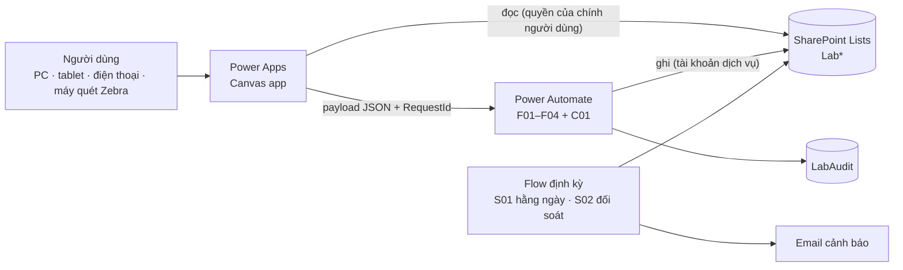
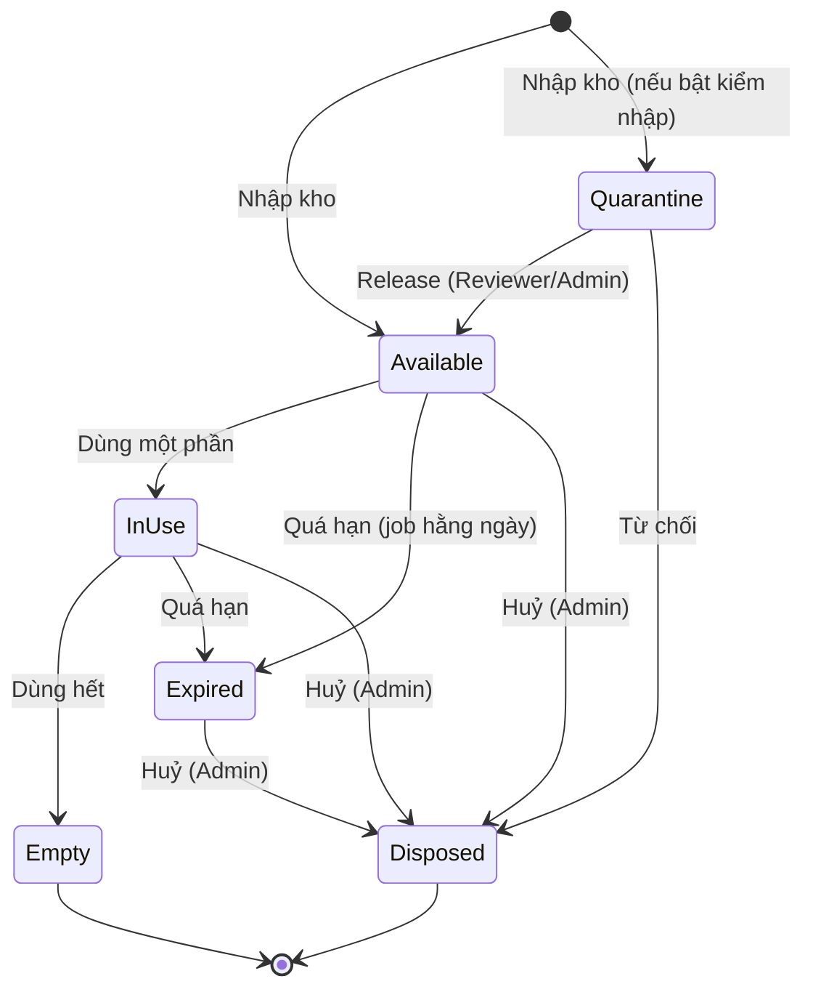
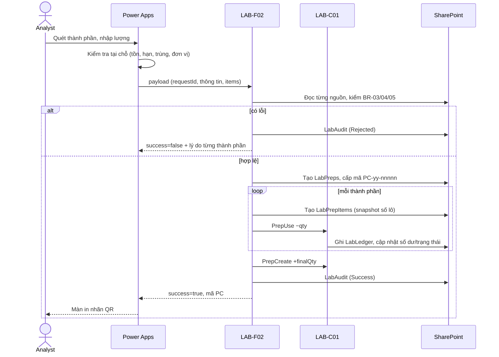

# 01 — Thiết kế tổng thể

## 1. Mục tiêu và phạm vi

Ứng dụng giúp người làm trong phòng lab **đăng ký, theo dõi và truy xuất hoá chất** thay cho sổ tay/Excel. Dữ liệu nằm trong SharePoint Lists, giao diện bằng Power Apps (Canvas), nghiệp vụ và kiểm soát chạy bằng Power Automate.

**Trong phạm vi giai đoạn 1 (đã thiết kế):** 5 yêu cầu anh nêu + các thành phần bắt buộc để chúng hoạt động đáng tin cậy (phân quyền, sổ cái, nhật ký kiểm toán, cảnh báo hạn dùng và sắp hết theo %, in nhãn có QR + mã vạch).

**Chưa làm (giai đoạn 2):** duyệt nhập kho bằng Approvals, thông báo qua Teams, PDF nhãn tự động, xuất báo cáo truy xuất PDF/Excel, upload COA từ app, mã vạch 1D, ảnh GHS trên nhãn, quản lý chất đặc biệt, đặt hàng/mua sắm.

## 2. Yêu cầu → tính năng

| # | Yêu cầu của anh | Tính năng | Màn hình | List | Flow |
|---|---|---|---|---|---|
| 1 | Đăng ký hoá chất đầu vào | Nhập theo danh mục, số lô NSX, hạn dùng, lượng, vị trí, COA; **mỗi chai một mã** `IN-yy-nnnnn`; hỗ trợ nhập nhiều chai cùng lô; kiểm tra hạn dùng, đơn vị, trùng | `scrLotRegister`, `scrLabel` | `LabCatalog`, `LabLocations`, `LabLots`, `LabLedger` | F01 |
| 2 | Đăng ký pha chế hoá chất | Wizard 3 bước; thành phần là chai hoặc dung dịch pha khác; kiểm tra tồn/hạn ngay khi nhập; tự trừ tồn; mã `PC-yy-nnnnn`; hạn dùng không vượt hạn thành phần; duyệt 4 mắt | `scrPrepRegister`, `scrLabel` | `LabPreps`, `LabPrepItems`, `LabLedger` | F02, C01, F04 |
| 3 | Theo dõi lượng còn lại | Số dư theo sổ cái; thanh còn lại, trạng thái tự động (Sẵn sàng/Đang dùng/Hết/Hết hạn); lọc, gộp theo hoá chất; cảnh báo **sắp hết theo % (đặt riêng từng hoá chất hoặc dùng mặc định chung)** & sắp hết hạn; lịch sử từng chai | `scrHome`, `scrInventory`, `scrDetail`, `scrUsage` | `LabLedger`, `LabLots`, `LabPreps` | F03, C01, S01, S02 |
| 4 | Truy xuất biên bản thử nghiệm qua mã hoá chất pha | Gắn hoá chất vào **số biên bản** khi dùng; tra ngược từ mã pha → công thức → chai/lô/COA; tra xuôi từ chai → dung dịch → biên bản (phục vụ thu hồi theo lô) | `scrUsage`, `scrTrace` | `LabTestUsage`, `LabPrepItems` | F03 |
| 5 | QR code / mã vạch để quét | Nhãn mỗi chai/dung dịch có **QR + mã vạch Code 39**; quét bằng **máy Zebra cầm tay (hoạt động như bàn phím, không cần camera)** hoặc camera điện thoại; hiểu cả mã trơn lẫn link; mở thẳng chi tiết | `scrScan`, `scrLabel` | — | — |

## 3. Giả định đã dùng (cần anh xác nhận — xem [05 §7](05-Bao-mat-va-Kiem-thu.md))

1. **Biên bản thử nghiệm** (xem mục 3a) đã có sẵn (ở thư viện SharePoint hoặc nơi khác) và người dùng nhập **số biên bản + link**; app không tạo biên bản.
2. Quản lý theo **chai/đơn vị vật lý**, mỗi chai một nhãn.
3. Số lượng lưu theo **đơn vị gốc** (g, mL, pcs); app lo quy đổi khi nhập.
4. Thiết bị: máy tính + **máy quét Zebra cầm tay** (giả định kiểu USB/Bluetooth hoạt động như bàn phím, chưa biết model, 1D hay 2D); điện thoại/máy tính bảng chỉ là phụ.
5. Quy mô phòng lab vừa (vài nghìn chai/năm, vài chục người dùng).
6. Có thể xin tài khoản dịch vụ để làm chủ flow và môi trường hỗ trợ Solution.
7. Ngôn ngữ giao diện: tiếng Việt.

## 3a. Thuật ngữ cần thống nhất

| Thuật ngữ | Nghĩa trong tài liệu này |
|---|---|
| **Biên bản thử nghiệm** | Tài liệu ghi lại **một lần thử nghiệm trên một mẫu** (còn gọi báo cáo / phiếu kết quả thử nghiệm, *test report*): mẫu nào, chỉ tiêu gì, phương pháp nào, ngày nào, ai làm, **dùng thiết bị và hoá chất/dung dịch nào**, kết quả ra sao, ai duyệt. App chỉ lưu **số biên bản** (và link tới file nếu có) để nối biên bản với các hoá chất đã dùng. |
| Vì sao phải nối | Khi một dung dịch pha hoặc một lô hoá chất có vấn đề (pha sai, nhà cung cấp thu hồi lô, dùng quá hạn), phòng lab phải tìm ra **mọi biên bản đã dùng nó** để đánh giá ảnh hưởng đến kết quả đã phát hành. Ngược lại, khi rà soát một biên bản, phải chứng minh được hoá chất trong đó còn hạn, được pha và duyệt đúng. Phòng lab theo ISO/IEC 17025 thường cần chứng minh được điều này. |
| **COA** (Certificate of Analysis) | Giấy chứng nhận chất lượng của **nhà cung cấp** đi kèm *chai hoá chất*. Không phải biên bản thử nghiệm. App lưu link COA ở từng chai. |
| **Chai / lô** | *Chai* = một đơn vị vật lý có nhãn QR riêng (`IN-yy-nnnnn`). *Lô* = số lô của nhà sản xuất, nhiều chai có thể cùng lô. |
| **Dung dịch pha** | Hoá chất do phòng lab tự pha từ các chai hoặc từ dung dịch pha khác (`PC-yy-nnnnn`). |
| **Lượng tồn chuẩn** | Lượng của một hoá chất mà phòng lab muốn có khi kho đầy đủ; là mốc 100% để tính % còn lại và cảnh báo cần mua thêm. |

## 4. Kiến trúc

Điểm mấu chốt: **người dùng chỉ đọc, flow mới ghi**. Chi tiết quyền ở [05](05-Bao-mat-va-Kiem-thu.md); dữ liệu ở [02](02-Mo-hinh-du-lieu.md); flow ở [03](03-Power-Automate.md); màn hình/công thức ở [04](04-Power-Apps.md).

## 5. Luồng nghiệp vụ

### 5.1 Vòng đời chai đầu vào

Dung dịch pha có vòng đời tương tự (không có `Quarantine`) cộng thêm trạng thái duyệt `Pending → Approved/Rejected`. Đối tượng ở trạng thái `Empty`, `Expired`, `Disposed` **vẫn tra cứu và truy xuất được** — chỉ không dùng thêm được.

### 5.2 Đăng ký pha chế (luồng quan trọng nhất)

### 5.3 Gắn biên bản và truy xuất

1. Khi làm thử nghiệm, người dùng mở **Ghi nhận sử dụng**, nhập số biên bản, quét các mã hoá chất đã dùng và lượng → F03 trừ tồn và ghi `LabTestUsage`.
2. Muốn truy xuất: nhập/quét mã dung dịch pha → app dựng **cây nguồn gốc** (đến chai, số lô NSX, COA) và **danh sách biên bản** đã dùng dung dịch đó.
3. Truy xuôi: quét mã chai/lô → thấy mọi dung dịch hậu duệ và biên bản liên quan (tối đa 3 cấp) — dùng khi nhà cung cấp thông báo lô có vấn đề.

### 5.4 Vòng đời mã QR

1. Mã sinh ra khi **lưu** (không phải khi mở biểu mẫu) → luôn duy nhất.
2. App chuyển thẳng sang màn in nhãn; nhãn gồm QR + mã + tên + số lô/nồng độ + hạn dùng + vị trí.
3. Quét: camera app, súng quét hoặc (nếu bật DeepLink) camera điện thoại thường.
4. Nhãn hỏng/mất: in lại từ `scrDetail`, mã không đổi.

## 6. Quyết định thiết kế chính

| # | Quyết định | Lý do | Đánh đổi |
|---|---|---|---|
| D1 | Sổ cái (`LabLedger`) là nguồn sự thật, số dư là cache | Kiểm toán được, tự sửa lệch, không mất dữ liệu khi có lỗi | Thêm một list và một bước đối soát |
| D2 | Mọi thao tác ghi đi qua flow | Kiểm tra quyền và nghiệp vụ phía server; người dùng không cần quyền ghi; ghi nhật ký đồng nhất | Phụ thuộc Power Automate; độ trễ vài giây mỗi lần lưu |
| D3 | Quan hệ bằng ID số + mã snapshot, không dùng Lookup column | Tránh giới hạn lookup/view và cảnh báo delegation | Toàn vẹn tham chiếu do flow bảo đảm |
| D4 | Mã `yy-nnnnn` lấy từ SharePoint `ID` | Không có race condition, không cần bảng bộ đếm, duy nhất tuyệt đối | Có thể có khoảng trống số; số không reset theo năm |
| D5 | Một chai một mã | Theo dõi còn lại chính xác theo từng chai | Nhập 20 chai tạo 20 dòng (đã tối ưu bằng chạy song song) |
| D6 | QR mặc định chỉ chứa mã | Mọi đầu đọc hiểu; không lộ thông tin; DeepLink bật sau | Điện thoại thường quét ra chữ, không mở app |
| D7 | Canvas app: Modern controls + named formulas + component | Giao diện hiện đại, dễ bảo trì, truy cập tốt | Một số control (gallery, barcode scanner) vẫn là classic |
| D8 | SharePoint List (theo yêu cầu) thay vì Dataverse | Đúng chỉ định, chi phí và quản trị đơn giản | Không có transaction/khoá bản ghi thật sự → bù bằng ledger + đối soát (R-01); nếu mở rộng nên cân nhắc Dataverse |
| D9 | Không xoá; sửa bằng bút toán đảo có lý do | Yêu cầu kiểm toán/hồ sơ phòng lab | Dữ liệu tăng dần → có kế hoạch lưu trữ |
| D10 | Quét bằng máy Zebra cầm tay qua ô nhập văn bản (kiểu bàn phím) + Timer; camera chỉ là phụ | Máy cầm tay không có camera, không gửi hình; control camera của Power Apps không chạy trong trình duyệt | Ô nhập phải luôn giữ focus; máy 1D không đọc được QR → nhãn in thêm Code 39 |
| D11 | Cảnh báo sắp hết theo % của *lượng tồn chuẩn*; mặc định 20%, mỗi hoá chất có thể đặt riêng | Một con số mặc định dùng ngay được, ai cần thì tinh chỉnh; mốc 100% tự lấy từ tồn cao nhất đã đạt nếu chưa đặt | % so với "tồn chuẩn" chứ không phải so với từng chai — cần Admin đặt tồn chuẩn cho hoá chất quan trọng |

## 7. Lộ trình triển khai

| Giai đoạn | Nội dung | Kết quả kiểm tra |
|---|---|---|
| 0 | Chốt câu hỏi mở ([05 §7](05-Bao-mat-va-Kiem-thu.md)), xin môi trường, tài khoản dịch vụ, nhóm bảo mật | Quyết định bằng văn bản |
| 1 | Chạy `New-LabChemLists.ps1 -SeedData -AdminEmail …`; nạp danh mục, vị trí, vai trò | Lists đúng schema; `-ApplyPermissions` kiểm bằng tài khoản thường |
| 2 | Dựng `LAB-C01`, `LAB-F01` | T-IN-*, T-RM-01 |
| 3 | App: khung điều hướng, `scrHome`, `scrScan`, `scrInventory`, `scrDetail`, `scrLotRegister`, `scrLabel` | T-SC-*, T-IN-* trên thiết bị thật |
| 4 | `LAB-F02`, `LAB-F03`, `scrPrepRegister`, `scrUsage`, `scrTrace` | T-PR-*, T-US-*, T-TR-* |
| 5 | `LAB-F04`, `LAB-S01`, `LAB-S02`, `scrAdmin` | T-RM-02…06, T-SEC-06 |
| 6 | Rà soát bảo mật go-live, UAT, chạy thử 2 tuần với dữ liệu thật | Nghiệm thu theo [05 §6.3](05-Bao-mat-va-Kiem-thu.md) |

Thứ tự này đưa người dùng vào dùng được sớm nhất ở giai đoạn 3 (nhập, quét, xem tồn) rồi mới thêm pha chế và truy xuất.
