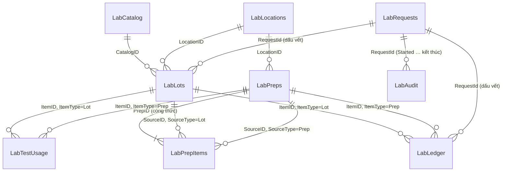

# 02 — Mô hình dữ liệu (SharePoint Lists)

> Tài liệu này được **sinh tự động** từ [sharepoint/LabChem.Schema.ps1](../sharepoint/LabChem.Schema.ps1) — đó là nguồn sự thật duy nhất. Muốn đổi cột: sửa file schema, chạy lại script tạo list, chạy `./tools/Build-DataModelDoc.ps1` để sinh lại tài liệu. Đừng sửa tay các bảng bên dưới.

## 1. Nguyên tắc thiết kế

1. **Sổ cái là nguồn sự thật cho lượng còn lại.** Mọi biến động ghi thành một dòng `LabLedger` (chỉ thêm, không sửa/xoá). `RemainingQty` trên `LabLots`/`LabPreps` chỉ là bản cache để hiển thị nhanh, được flow tính lại từ sổ cái. Nhờ vậy có thể kiểm toán và tự sửa lỗi lệch số.
2. **App chỉ đọc, flow mới ghi.** Người dùng — kể cả Admin — chỉ có quyền *Read* trên các list; mọi thay đổi (tồn kho, danh mục, vị trí, cấu hình, vai trò) đi qua Power Automate (tài khoản dịch vụ) có kiểm tra phía server và để lại nhật ký. Xem [05](05-Bao-mat-va-Kiem-thu.md).
3. **Không xoá.** Sai thì điều chỉnh/đảo bút toán có lý do; list không cấp quyền Delete cho ai ngoài Owner.
4. **Quan hệ bằng `ID` (Number) + mã snapshot (Text), không dùng Lookup column.** Tránh giới hạn 12 cột lookup/view của SharePoint và việc lọc theo lookup không delegable trong Power Apps. Đổi lại, tính toàn vẹn tham chiếu do flow bảo đảm (chỉ flow ghi nên đủ an toàn).
5. **Snapshot tên/hãng/số lô** vào bản ghi con để hồ sơ truy xuất không đổi khi danh mục bị chỉnh sửa về sau (yêu cầu của truy xuất nguồn gốc).
6. **Enum máy dùng khoá tiếng Anh** (`Status`, `TxnType`...), app ánh xạ sang nhãn tiếng Việt và màu — logic không phụ thuộc chuỗi có dấu.
7. **Mỗi chai/đơn vị vật lý = một dòng `LabLots` = một mã QR.** Đăng ký 10 chai cùng lô tạo 10 dòng.
8. **Mọi số lượng lưu theo đơn vị gốc** của hoá chất (g, mL hoặc pcs); đổi đơn vị (mg, kg, µL, L) làm ở giao diện nhập.
9. **Nhật ký đầy đủ, không thể bỏ qua.** Mỗi yêu cầu để lại: một dòng `LabRequests` (nhận yêu cầu, duy nhất theo `RequestId`) → dòng `LabAudit` *Started* (ghi **trước** khi làm; ghi không được thì không làm) → một dòng `LabAudit` cho **từng đối tượng bị đổi** (kèm giá trị trước/sau và lý do) → dòng kết thúc *Success/Rejected/Error*. Mọi bản ghi do yêu cầu tạo ra mang `RequestId` nên dựng lại được toàn bộ dấu vết. Danh tính người thực hiện là **email dạng văn bản** lấy từ phía server, không phải cột Người. Chi tiết: [03 §2.5–2.7](03-Power-Automate.md).

## 2. Sơ đồ quan hệ

**Chuỗi truy xuất:** Biên bản thử nghiệm ← `LabTestUsage` ← dung dịch pha (`LabPreps`) ← `LabPrepItems` ← chai đầu vào (`LabLots`, kèm số lô NSX + COA) — và đệ quy nếu thành phần lại là một dung dịch pha khác (dung dịch gốc → dung dịch làm việc).

## 3. Định danh và nội dung QR

| Đối tượng | Mã | Cách sinh |
|---|---|---|
| Chai đầu vào | `IN-yy-nnnnn` (vd `IN-26-00042`) | `yy` = 2 số cuối năm, `nnnnn` = SharePoint `ID` của item, đệm 5 chữ số |
| Dung dịch pha | `PC-yy-nnnnn` (vd `PC-26-00017`) | tương tự, theo `ID` của `LabPreps` |

- Flow tạo item với `Title` tạm (GUID) rồi cập nhật `Title` = mã tính từ `ID` → **không có race condition** khi nhiều người đăng ký cùng lúc, không cần bảng bộ đếm.
- `Title` đặt *Enforce unique values* nên không thể trùng mã.
- Mã không tái sử dụng, kể cả khi item bị vô hiệu.
- **Nội dung QR** (cấu hình `QRMode`): `CodeOnly` = chỉ chứa mã (ưu tiên: mọi đầu đọc đều hiểu, không lộ thông tin); `DeepLink` = `<AppLink>&code=<mã>` để quét bằng camera điện thoại là mở thẳng app. Parser trong app hiểu cả hai dạng.

## 4. Quy đổi đơn vị

Lưu ở đơn vị gốc; giao diện cho nhập đơn vị thuận tiện rồi quy đổi trước khi gửi flow.

| Nhập | Đơn vị gốc | Hệ số |
|---|---|---|
| mg | g | 0.001 |
| g | g | 1 |
| kg | g | 1000 |
| µL | mL | 0.001 |
| mL | mL | 1 |
| L | mL | 1000 |
| pcs | pcs | 1 |

Flow luôn kiểm tra `Unit` của giao dịch khớp `Unit` của đối tượng; không bao giờ tự quy đổi phía server (tránh sai âm thầm).

## 5. Quy tắc nghiệp vụ (flow thực thi phía server)

| Mã | Quy tắc |
|---|---|
| BR-01 | `RemainingQty` = Σ `QtyDelta` của `LabLedger` theo (`ItemType`, `ItemID`). |
| BR-02 | Số dư không được âm: giao dịch làm số dư < 0 bị từ chối và ghi `LabAudit` (Result = Rejected). Dòng sổ cái đã ghi **không bao giờ bị sửa**; sai thì ghi dòng `Reversal`/`Adjust` mới. |
| BR-03 | Chỉ được dùng (pha / thử nghiệm) đối tượng có `Status` ∈ {Available, InUse}, `ExpiryDate` ≥ ngày giao dịch, `IsVoid` = false; dung dịch pha còn phải có `ReviewStatus` ≠ Rejected. Quarantine / Empty / Expired / Disposed bị chặn. |
| BR-04 | `Unit` của giao dịch phải bằng `Unit` của đối tượng. |
| BR-05 | Nếu `EnforcePrepExpiryLimit` = true: `ExpiryDate` dung dịch pha ≤ hạn dùng sớm nhất của các thành phần. |
| BR-06 | Không xoá. Sai sót sửa bằng `Adjust` / `Reversal` kèm lý do (Admin). `Void` chỉ khi đối tượng chưa phát sinh hậu duệ (chưa dùng để pha, chưa gắn biên bản); nếu đã có thì phải `Dispose`. |
| BR-07 | Mỗi chai một mã; mã không tái sử dụng. |
| BR-08 | Người duyệt (`ReviewedBy`) phải khác người pha (`PreparedBy`). |
| BR-09 | Dùng cho thử nghiệm thì bắt buộc có `Số biên bản`. |
| BR-10 | `Status` tự động: số dư = 0 → Empty; 0 < số dư < ban đầu → InUse; quá hạn → Expired (job hằng ngày). Chai/dung dịch Expired hoặc Empty vẫn tra cứu và truy xuất được. |
| BR-11 | Công thức pha (`LabPrepItems`) bất biến sau khi tạo. |
| BR-12 | Mỗi yêu cầu ghi mang một `RequestId` (GUID cho một *ý định* thao tác). Flow **nhận** `RequestId` vào `LabRequests` (duy nhất) trước khi làm gì; gửi lại cùng `RequestId` không bao giờ chạy lại — trả kết quả đã lưu, báo "đang xử lý", hoặc báo "bị gián đoạn" để Admin kiểm tra. Bị từ chối thì app sinh `RequestId` mới cho lần thử sau. |
| BR-13 | **Cảnh báo sắp hết (cần mua thêm):** với mỗi hoá chất, `Tổng tồn` = Σ `RemainingQty` của các chai `Available`/`InUse`/`Quarantine` (hàng đã nhập nhưng đang chờ kiểm vẫn tính là có hàng, để không mua trùng). `Mốc 100%` = `ParLevelQty` nếu có, ngược lại `PeakQty`. `Ngưỡng` = `LowStockPct` của hoá chất nếu có, ngược lại `DefaultLowStockPct`. Cảnh báo khi `Tổng tồn < Mốc 100% × Ngưỡng / 100` (kể cả khi đã hết sạch). Riêng từng chai đang dùng: tô vàng khi `RemainingQty / InitialQty × 100 < Ngưỡng`. |
| BR-14 | **Không có nhật ký thì không có thao tác (fail-closed).** Flow ghi `LabAudit` *Started* trước khi thay đổi bất cứ thứ gì; ghi không được thì dừng, không đổi dữ liệu. Mọi yêu cầu — kể cả bị từ chối, của người không có vai trò, hay gặp lỗi — có đủ dòng *Started* và một dòng kết thúc. |
| BR-15 | Mọi bản ghi do flow tạo (`LabLots`, `LabPreps`, `LabPrepItems`, `LabLedger`, `LabTestUsage`) mang `RequestId`; sổ cái và nhật ký mang `ActorEmail` do server xác định. Mỗi đối tượng bị đổi có dòng `LabAudit` riêng; hành động mức *Critical* bắt buộc có lý do và giá trị trước/sau. |
| BR-16 | Danh mục, vị trí, cấu hình và vai trò **chỉ** đổi qua `LAB-F05`: Admin, có lý do, ghi trước/sau. Không đổi đơn vị gốc của hoá chất đã có chai; không tự hạ quyền chính mình; không bỏ Admin cuối cùng. |
| BR-17 | Nhật ký (`LabAudit`) và sổ cái (`LabLedger`) chỉ thêm: tài khoản flow không có quyền sửa/xoá. Dòng bị sửa, bị xoá hoặc khoảng trống bất thường bị `LAB-S03` phát hiện và báo Admin. |

## 6. Cấu hình mặc định (`LabSettings`)

| Khoá | Giá trị | Ý nghĩa |
|---|---|---|
| `LabName` | `Phòng thí nghiệm` | Tên hiển thị trên tiêu đề app và nhãn. |
| `ExpiryWarnDays` | `30` | Cảnh báo hoá chất/dung dịch sắp hết hạn trong N ngày. |
| `DefaultLowStockPct` | `20` | Ngưỡng cảnh báo sắp hết (%) mặc định, dùng cho hoá chất không tự đặt LowStockPct. Chai đang dùng dưới % này (so với lượng ban đầu) cũng được tô vàng. |
| `LabelBarcode` | `Code39` | Mã vạch tuyến tính in thêm trên nhãn để máy quét 1D (laser) đọc được: Code39 hoặc None. QR luôn được in. |
| `RequireIncomingRelease` | `false` | true: hoá chất mới nhập ở trạng thái Quarantine, Reviewer/Admin phải Release mới dùng được. |
| `EnforcePrepExpiryLimit` | `true` | true: hạn dùng dung dịch pha không được vượt hạn dùng sớm nhất của thành phần. |
| `MaxBottlesPerReceipt` | `20` | Số chai tối đa tạo trong một lần đăng ký nhập. |
| `AlertEmails` | _(trống)_ | Danh sách email nhận báo cáo hằng ngày (phân tách bằng dấu chấm phẩy). |
| `ReportUrlAllowedHosts` | _(trống)_ | Hậu tố host được phép cho link biên bản/COA, phân tách bằng dấu chấm phẩy (vd .sharepoint.com). Trống = mọi https. |
| `QRMode` | `CodeOnly` | CodeOnly: QR chứa mã nội bộ. DeepLink: QR chứa link mở thẳng app (cần AppLink). |
| `QRBaseUrl` | `https://api.qrserver.com/v1/create-qr-code/?size=300x300&margin=0&data=` | PILOT ONLY. Dịch vụ tạo ảnh QR công cộng, chỉ nhận mã nội bộ. Thay bằng PCF/dịch vụ nội bộ trước khi go-live (xem docs/05). |
| `AlertOnCritical` | `true` | true: gửi email ngay tới AlertEmails khi có sự kiện mức Critical (điều chỉnh tồn, huỷ, vô hiệu, đổi cấu hình/vai trò, cảnh báo toàn vẹn). |
| `RequestStaleMinutes` | `15` | Yêu cầu ở trạng thái InProgress quá số phút này được coi là bị gián đoạn (LAB-S03 xử lý, không tự chạy lại). |
| `LogTraceViews` | `false` | true: ghi nhật ký cả lượt mở màn Truy xuất (sự kiện do app báo). Mặc định tắt để nhật ký không loãng. |
| `AppLink` | _(trống)_ | Link play của app, ví dụ https://apps.powerapps.com/play/<appId>?tenantId=<tid>. Dùng khi QRMode=DeepLink. |

## 7. Dung lượng và giới hạn SharePoint

- Ước tính tham khảo: 3.000 chai + 2.000 dung dịch/năm → `LabLedger` ~ 40.000 dòng/năm. SharePoint chứa tới 30 triệu item/list; ngưỡng 5.000 chỉ chặn truy vấn **không có index** → các cột lọc/sắp xếp đều đã đánh index.
- App đặt *Data row limit* = 2.000 và chỉ dùng hàm delegable (`Filter`, `StartsWith`, `LookUp`, `Sort` theo cột index). KPI dạng đếm (`CountRows`) chính xác đến 2.000 kết quả/phép lọc; nếu số chai đang quản lý vượt ngưỡng này thì chuyển KPI sang snapshot do flow hằng ngày ghi vào `LabSettings`.
- Mỗi list tối đa 20 cột index (hiện dùng ≤ 9).
- `LabAudit` lớn nhanh nhất: mỗi yêu cầu để lại từ 3 dòng (Started + đối tượng + kết thúc) đến khoảng 25 dòng (nhập 20 chai) → ước tính **50.000–150.000 dòng/năm** cho quy mô vài trăm thao tác/ngày. Vẫn xa giới hạn 30 triệu, nhưng truy vấn trong app phải lọc theo cột có index (`Created`, `EntityCode`, `ActorEmail`, `RequestId`) và sắp theo `ID`; xuất lưu trữ hằng tháng, lưu trữ theo năm (xem [05 §4](05-Bao-mat-va-Kiem-thu.md)).
- Lưu trữ dài hạn: theo quy định hồ sơ của phòng lab (ví dụ ISO/IEC 17025 thường yêu cầu giữ hồ sơ nhiều năm) — chưa xác nhận với anh, xem câu hỏi mở trong [01](01-Thiet-ke-tong-the.md).

---

## Phụ lục — Chi tiết từng list

### 1. LabCatalog — Danh mục hoá chất

Danh mục hoá chất (master data). Chỉ Admin chỉnh sửa, và chỉ qua flow LAB-F05 (có nhật ký trước/sau).

| Cột (InternalName) | Hiển thị | Kiểu | Bắt buộc | Index | Giá trị / mặc định | Ghi chú |
|---|---|---|:-:|:-:|---|---|
| `Title` | Tên hoá chất | Văn bản | ✔ | ✔ |  | |
| `CasNumber` | Số CAS | Văn bản |  | ✔ |  |  |
| `ChemType` | Loại | Lựa chọn |  |  | Chất gốc, Dung môi, Chất chuẩn, Dung dịch đệm, Môi trường, Khác (mặc định: Chất gốc) |  |
| `Grade` | Cấp độ tinh khiết | Lựa chọn |  |  | AR, GR, ACS, HPLC, LC-MS, Technical, CRM, Khác |  |
| `BaseUnit` | Đơn vị gốc | Lựa chọn | ✔ |  | g, mL, pcs (mặc định: g) | Mọi số lượng của hoá chất này đều lưu theo đơn vị gốc (g, mL hoặc pcs). |
| `HazardClass` | Phân loại nguy hiểm (GHS) | Nhiều lựa chọn |  |  | Dễ cháy, Ăn mòn, Độc cấp tính, Oxy hoá, Kích ứng, Nguy hại sức khoẻ, Nguy hại môi trường, Khí nén, Dễ nổ, Không nguy hiểm |  |
| `StorageCondition` | Điều kiện bảo quản | Lựa chọn |  |  | 15-25 °C (phòng), 2-8 °C, -20 °C, -80 °C, Tủ chống cháy, Tủ hút, Tránh ánh sáng |  |
| `ParLevelQty` | Lượng tồn chuẩn | Số |  |  | 4 số lẻ, ≥ 0 | Lượng muốn có khi kho đầy đủ (đơn vị gốc). Là mốc 100% để tính % còn lại. Để trống = hệ thống dùng PeakQty. |
| `LowStockPct` | Ngưỡng cảnh báo (%) | Số |  |  | 0 số lẻ, ≥ 1, ≤ 99 | Cảnh báo cần mua thêm khi tổng tồn nhỏ hơn % này của lượng tồn chuẩn. Để trống = dùng DefaultLowStockPct trong LabSettings. |
| `PeakQty` | Tồn cao nhất đã đạt | Số |  |  | 4 số lẻ, ≥ 0 | Hệ thống tự cập nhật (LAB-F01) sau mỗi lần nhập = tổng tồn lớn nhất từng đạt. Dùng làm lượng chuẩn khi ParLevelQty trống; Admin có thể đặt lại. |
| `SDSLink` | Link SDS | Hyperlink |  |  |  |  |
| `IsActive` | Đang sử dụng | Có/Không |  |  | mặc định: Có |  |

### 2. LabLocations — Vị trí lưu trữ

Vị trí lưu trữ (phòng / tủ / ngăn). Chỉ đổi qua flow LAB-F05.

| Cột (InternalName) | Hiển thị | Kiểu | Bắt buộc | Index | Giá trị / mặc định | Ghi chú |
|---|---|---|:-:|:-:|---|---|
| `Title` | Tên vị trí | Văn bản | ✔ | ✔ | duy nhất | |
| `Room` | Phòng | Văn bản |  |  |  |  |
| `Note` | Ghi chú | Nhiều dòng |  |  |  |  |
| `IsActive` | Đang sử dụng | Có/Không |  |  | mặc định: Có |  |

### 3. LabLots — Hoá chất đầu vào (mỗi chai một dòng)

Hoá chất đầu vào. Mỗi item = 1 chai/đơn vị vật lý, có 1 mã QR riêng. Chỉ flow được ghi.

| Cột (InternalName) | Hiển thị | Kiểu | Bắt buộc | Index | Giá trị / mặc định | Ghi chú |
|---|---|---|:-:|:-:|---|---|
| `Title` | Mã nội bộ | Văn bản | ✔ | ✔ | duy nhất | |
| `CatalogID` | ID danh mục | Số | ✔ | ✔ | 0 số lẻ | ID item trong LabCatalog. |
| `ChemName` | Tên hoá chất | Văn bản | ✔ | ✔ |  | Snapshot tại thời điểm nhập, để tra cứu nhanh không cần join. |
| `CasNumber` | Số CAS | Văn bản |  |  |  | Snapshot. |
| `MfgLot` | Số lô NSX | Văn bản |  | ✔ |  |  |
| `Manufacturer` | Hãng sản xuất | Văn bản |  |  |  |  |
| `Supplier` | Nhà cung cấp | Văn bản |  |  |  |  |
| `ReceivedDate` | Ngày nhận | Ngày | ✔ | ✔ |  |  |
| `MfgDate` | Ngày sản xuất | Ngày |  |  |  |  |
| `ExpiryDate` | Hạn dùng | Ngày |  | ✔ |  |  |
| `OpenedDate` | Ngày mở nắp | Ngày |  |  |  | Flow gán khi giao dịch xuất đầu tiên phát sinh (nếu để trống). |
| `InitialQty` | Lượng ban đầu | Số | ✔ |  | 4 số lẻ, ≥ 0 |  |
| `RemainingQty` | Lượng còn lại | Số |  |  | 4 số lẻ, ≥ 0 | Cache. Luôn bằng tổng QtyDelta của LabLedger; chỉ flow LAB-C01 cập nhật. |
| `Unit` | Đơn vị | Lựa chọn | ✔ |  | g, mL, pcs |  |
| `LocationID` | ID vị trí | Số |  |  | 0 số lẻ |  |
| `LocationName` | Vị trí | Văn bản |  |  |  | Snapshot tên vị trí. |
| `Status` | Trạng thái | Lựa chọn | ✔ | ✔ | Quarantine, Available, InUse, Empty, Expired, Disposed (mặc định: Available) |  |
| `COALink` | Link COA | Hyperlink |  |  |  |  |
| `RegisteredBy` | Người đăng ký | Người |  |  |  | Người gọi flow (lấy từ danh tính, không nhận từ client). |
| `Note` | Ghi chú | Nhiều dòng |  |  |  |  |
| `IsVoid` | Đã vô hiệu | Có/Không |  |  | mặc định: Không |  |
| `VoidReason` | Lý do vô hiệu | Nhiều dòng |  |  |  |  |
| `RequestId` | Request Id | Văn bản |  | ✔ |  | Yêu cầu đã tạo bản ghi này: dựng lại dấu vết của một yêu cầu và phát hiện bản ghi dở dang. |

### 4. LabPreps — Hoá chất pha

Hoá chất pha chế / dung dịch pha. Chỉ flow được ghi.

| Cột (InternalName) | Hiển thị | Kiểu | Bắt buộc | Index | Giá trị / mặc định | Ghi chú |
|---|---|---|:-:|:-:|---|---|
| `Title` | Mã hoá chất pha | Văn bản | ✔ | ✔ | duy nhất | |
| `PrepName` | Tên dung dịch | Văn bản | ✔ | ✔ |  |  |
| `PrepType` | Loại dung dịch | Lựa chọn |  |  | Dung dịch gốc, Dung dịch làm việc, Dung dịch đệm, Thuốc thử, Pha loãng, Khác (mặc định: Dung dịch làm việc) |  |
| `Concentration` | Nồng độ | Văn bản |  |  |  | Văn bản tự do, ví dụ "0.1 mol/L", "1000 ppm". |
| `SOPRef` | SOP / phương pháp | Văn bản |  |  |  |  |
| `Procedure` | Cách pha | Nhiều dòng |  |  |  |  |
| `PrepDate` | Ngày pha | Ngày | ✔ | ✔ |  |  |
| `ExpiryDate` | Hạn dùng | Ngày | ✔ | ✔ |  | Không vượt hạn dùng sớm nhất của thành phần (cấu hình EnforcePrepExpiryLimit). |
| `FinalQty` | Lượng sau pha | Số | ✔ |  | 4 số lẻ, ≥ 0 |  |
| `RemainingQty` | Lượng còn lại | Số |  |  | 4 số lẻ, ≥ 0 | Cache. Luôn bằng tổng QtyDelta của LabLedger. |
| `Unit` | Đơn vị | Lựa chọn | ✔ |  | g, mL, pcs |  |
| `LocationID` | ID vị trí | Số |  |  | 0 số lẻ |  |
| `LocationName` | Vị trí | Văn bản |  |  |  |  |
| `StorageCondition` | Điều kiện bảo quản | Lựa chọn |  |  | 15-25 °C (phòng), 2-8 °C, -20 °C, -80 °C, Tủ chống cháy, Tủ hút, Tránh ánh sáng |  |
| `Status` | Trạng thái | Lựa chọn | ✔ | ✔ | Available, InUse, Empty, Expired, Disposed (mặc định: Available) |  |
| `ReviewStatus` | Trạng thái duyệt | Lựa chọn |  |  | Pending, Approved, Rejected (mặc định: Pending) |  |
| `ReviewedBy` | Người duyệt | Người |  |  |  | Phải khác PreparedBy (nguyên tắc 4 mắt). |
| `ReviewedOn` | Ngày duyệt | Ngày giờ |  |  |  |  |
| `PreparedBy` | Người pha | Người |  |  |  |  |
| `Note` | Ghi chú | Nhiều dòng |  |  |  |  |
| `IsVoid` | Đã vô hiệu | Có/Không |  |  | mặc định: Không |  |
| `VoidReason` | Lý do vô hiệu | Nhiều dòng |  |  |  |  |
| `RequestId` | Request Id | Văn bản |  | ✔ |  | Yêu cầu đã tạo bản ghi này. |

### 5. LabPrepItems — Thành phần của mỗi lần pha

Thành phần của mỗi lần pha (công thức thực tế). Nguồn có thể là chai đầu vào hoặc một dung dịch pha khác.

| Cột (InternalName) | Hiển thị | Kiểu | Bắt buộc | Index | Giá trị / mặc định | Ghi chú |
|---|---|---|:-:|:-:|---|---|
| `Title` | Mã hoá chất pha | Văn bản | ✔ | ✔ |  | |
| `PrepID` | ID dung dịch pha | Số | ✔ | ✔ | 0 số lẻ |  |
| `SourceType` | Loại nguồn | Lựa chọn | ✔ |  | Lot, Prep |  |
| `SourceID` | ID nguồn | Số | ✔ | ✔ | 0 số lẻ |  |
| `SourceCode` | Mã nguồn | Văn bản | ✔ | ✔ |  |  |
| `SourceName` | Tên nguồn | Văn bản |  |  |  | Snapshot. |
| `SourceMfgLot` | Số lô NSX nguồn | Văn bản |  |  |  | Snapshot, chỉ có khi nguồn là Lot; phục vụ truy xuất nhanh. |
| `ItemRole` | Vai trò | Lựa chọn |  |  | Chất tan, Dung môi, Phụ gia (mặc định: Chất tan) |  |
| `QtyUsed` | Lượng dùng | Số | ✔ |  | 4 số lẻ, ≥ 0 |  |
| `Unit` | Đơn vị | Lựa chọn | ✔ |  | g, mL, pcs |  |
| `RequestId` | Request Id | Văn bản |  | ✔ |  | Yêu cầu đã tạo bản ghi này. |

### 6. LabLedger — Sổ cái xuất/nhập

Sổ cái xuất/nhập (append-only: tài khoản flow chỉ có quyền Add, không Edit/Delete). Số dư của Lot/Prep = tổng QtyDelta. Nguồn sự thật cho lượng còn lại.

| Cột (InternalName) | Hiển thị | Kiểu | Bắt buộc | Index | Giá trị / mặc định | Ghi chú |
|---|---|---|:-:|:-:|---|---|
| `Title` | Mã đối tượng | Văn bản | ✔ | ✔ |  | |
| `ItemType` | Loại đối tượng | Lựa chọn | ✔ |  | Lot, Prep |  |
| `ItemID` | ID đối tượng | Số | ✔ | ✔ | 0 số lẻ |  |
| `TxnType` | Loại giao dịch | Lựa chọn | ✔ |  | Receive, PrepCreate, PrepUse, TestUse, Adjust, Dispose, Reversal |  |
| `QtyDelta` | Biến động | Số | ✔ |  | 4 số lẻ | Dương = nhập, âm = xuất. |
| `Unit` | Đơn vị | Lựa chọn | ✔ |  | g, mL, pcs |  |
| `BalanceAfter` | Số dư sau GD | Số |  |  | 4 số lẻ | Số dư tính tại thời điểm ghi, chỉ để tham khảo (có thể lệch nếu hai giao dịch chen nhau). Không bao giờ sửa sau khi ghi; nguồn sự thật là Σ QtyDelta. |
| `RefType` | Loại tham chiếu | Lựa chọn |  |  | Prep, Report, Manual |  |
| `RefCode` | Mã tham chiếu | Văn bản |  | ✔ |  | Mã dung dịch pha hoặc số biên bản liên quan. |
| `Reason` | Lý do | Nhiều dòng |  |  |  | Bắt buộc với Adjust / Dispose / Reversal. |
| `ReasonCode` | Mã lý do | Lựa chọn |  |  | EntryError, CountCorrection, Expired, Spilled, Contaminated, Waste, Other | Phân loại lý do để thống kê hao hụt. Bắt buộc với Adjust / Dispose. |
| `Actor` | Người thực hiện | Người |  |  |  | Chỉ để hiển thị tên. Danh tính chính thức là ActorEmail. |
| `ActorEmail` | Email người thực hiện | Văn bản | ✔ | ✔ |  | Danh tính lấy từ phía server lúc ghi; văn bản bất biến (không đổi khi người dùng đổi tên hoặc bị xoá). |
| `RequestId` | Request Id | Văn bản |  | ✔ |  | Yêu cầu đã tạo dòng này; nối với LabAudit. |

### 7. LabTestUsage — Liên kết biên bản thử nghiệm

Liên kết biên bản thử nghiệm với hoá chất đã dùng (1 dòng = 1 biên bản x 1 hoá chất).

| Cột (InternalName) | Hiển thị | Kiểu | Bắt buộc | Index | Giá trị / mặc định | Ghi chú |
|---|---|---|:-:|:-:|---|---|
| `Title` | Số biên bản | Văn bản | ✔ | ✔ |  | |
| `ReportUrl` | Link biên bản | Hyperlink |  |  |  |  |
| `TestName` | Phép thử / chỉ tiêu | Văn bản |  |  |  |  |
| `SampleCode` | Mã mẫu | Văn bản |  |  |  |  |
| `ItemType` | Loại đối tượng | Lựa chọn | ✔ |  | Lot, Prep |  |
| `ItemID` | ID đối tượng | Số | ✔ | ✔ | 0 số lẻ |  |
| `ItemCode` | Mã hoá chất | Văn bản | ✔ | ✔ |  |  |
| `ItemName` | Tên hoá chất | Văn bản |  |  |  | Snapshot. |
| `QtyUsed` | Lượng dùng | Số | ✔ |  | 4 số lẻ, ≥ 0 |  |
| `Unit` | Đơn vị | Lựa chọn | ✔ |  | g, mL, pcs |  |
| `UsedDate` | Ngày sử dụng | Ngày giờ | ✔ | ✔ |  |  |
| `Analyst` | Người thử nghiệm | Người |  |  |  |  |
| `Note` | Ghi chú | Nhiều dòng |  |  |  |  |
| `RequestId` | Request Id | Văn bản |  | ✔ |  | Yêu cầu đã tạo dòng này. |

### 8. LabAudit — Nhật ký kiểm toán

Nhật ký kiểm toán (append-only): mọi yêu cầu — thành công, bị từ chối, lỗi, kể cả của người không có quyền — đều để lại dấu vết. Tài khoản flow chỉ có quyền Add. Admin/Reviewer đọc.

| Cột (InternalName) | Hiển thị | Kiểu | Bắt buộc | Index | Giá trị / mặc định | Ghi chú |
|---|---|---|:-:|:-:|---|---|
| `Title` | Hành động | Văn bản | ✔ | ✔ |  | |
| `EntityType` | Loại đối tượng | Lựa chọn | ✔ |  | Lot, Prep, Catalog, Location, Role, Setting, Report, Request, System |  |
| `EntityID` | ID đối tượng | Số |  |  | 0 số lẻ |  |
| `EntityCode` | Mã đối tượng | Văn bản |  | ✔ |  |  |
| `Result` | Kết quả | Lựa chọn | ✔ |  | Started, Success, Rejected, Error, Warning | Started = đã nhận yêu cầu, chưa biết kết quả. Mọi yêu cầu có một dòng Started rồi một dòng kết thúc. |
| `Severity` | Mức | Lựa chọn | ✔ |  | Info, Important, Critical (mặc định: Info) | Critical = điều chỉnh tồn, huỷ, vô hiệu, đổi cấu hình/vai trò, cảnh báo toàn vẹn: gửi email ngay và liệt kê trong báo cáo hằng ngày. |
| `Reason` | Lý do | Nhiều dòng |  |  |  | Lý do do người dùng nhập (bắt buộc với các hành động Critical). |
| `BeforeValue` | Giá trị trước | Nhiều dòng |  |  |  | JSON các trường bị đổi, trước khi đổi. |
| `AfterValue` | Giá trị sau | Nhiều dòng |  |  |  | JSON các trường bị đổi, sau khi đổi. |
| `Detail` | Chi tiết | Nhiều dòng |  |  |  | JSON: payload (khi Started), kết quả hoặc lý do từ chối/lỗi kỹ thuật (khi kết thúc). |
| `ActorEmail` | Email người thực hiện | Văn bản | ✔ | ✔ |  | Lấy từ phía server, không nhận từ client. Văn bản bất biến, không phải tham chiếu người dùng nên không đổi khi đổi tên và luôn ghi được kể cả với tài khoản lạ. |
| `ActorName` | Họ tên lúc đó | Văn bản |  |  |  |  |
| `ActorRole` | Vai trò lúc đó | Văn bản |  |  |  | Vai trò trong LabRoles tại thời điểm ghi, hoặc None. |
| `Source` | Nguồn | Lựa chọn | ✔ |  | App, ClientReport, Scheduled, Script | App = flow do app gọi; ClientReport = sự kiện do app tự báo (độ tin cậy thấp hơn); Scheduled = flow định kỳ; Script = chạy tay. |
| `FlowName` | Flow | Văn bản |  |  |  |  |
| `RunId` | Flow run Id | Văn bản |  |  |  |  |
| `RequestId` | Request Id | Văn bản |  | ✔ |  | GUID do app sinh cho một ý định thao tác. Nối nhật ký với sổ cái và mọi bản ghi do yêu cầu đó tạo. |
| `ClientInfo` | Phiên bản app / thiết bị | Văn bản |  |  |  | App tự khai (không tin tuyệt đối), dùng để điều tra. |

### 9. LabRoles — Phân quyền nghiệp vụ

Phân quyền nghiệp vụ. Flow kiểm tra vai trò ở phía server; app chỉ dùng để ẩn/hiện chức năng. Chỉ đổi qua flow LAB-F05.

| Cột (InternalName) | Hiển thị | Kiểu | Bắt buộc | Index | Giá trị / mặc định | Ghi chú |
|---|---|---|:-:|:-:|---|---|
| `Title` | Email (UPN, chữ thường) | Văn bản | ✔ | ✔ | duy nhất | |
| `DisplayName` | Họ tên | Văn bản |  |  |  |  |
| `Role` | Vai trò | Lựa chọn | ✔ |  | Admin, Analyst, Reviewer, Viewer (mặc định: Viewer) |  |
| `IsActive` | Đang hiệu lực | Có/Không |  |  | mặc định: Có |  |

### 10. LabSettings — Cấu hình

Cấu hình dạng khoá-giá trị. Chỉ Admin chỉnh sửa, và chỉ qua flow LAB-F05.

| Cột (InternalName) | Hiển thị | Kiểu | Bắt buộc | Index | Giá trị / mặc định | Ghi chú |
|---|---|---|:-:|:-:|---|---|
| `Title` | Khoá | Văn bản | ✔ | ✔ | duy nhất | |
| `Value` | Giá trị | Văn bản |  |  |  |  |
| `Description` | Mô tả | Nhiều dòng |  |  |  |  |

### 11. LabRequests — Sổ nhận yêu cầu (chống chạy trùng)

Sổ nhận yêu cầu: mỗi RequestId đúng một dòng (duy nhất). Flow nhận yêu cầu vào đây trước khi làm gì để chặn chạy trùng. Chỉ flow ghi; người dùng không truy cập. Không phải bằng chứng kiểm toán (bằng chứng là LabAudit).

| Cột (InternalName) | Hiển thị | Kiểu | Bắt buộc | Index | Giá trị / mặc định | Ghi chú |
|---|---|---|:-:|:-:|---|---|
| `Title` | RequestId | Văn bản | ✔ | ✔ | duy nhất | |
| `FlowName` | Flow | Văn bản |  |  |  |  |
| `ActorEmail` | Người gọi (email) | Văn bản |  | ✔ |  |  |
| `State` | Trạng thái | Lựa chọn | ✔ | ✔ | InProgress, Done, Rejected, Error (mặc định: InProgress) |  |
| `ResultJson` | Kết quả đã trả | Nhiều dòng |  |  |  | JSON success/message/codes/state đã trả cho app; trả lại nguyên văn khi nhận lại cùng RequestId. |
| `RunId` | Flow run Id | Văn bản |  |  |  |  |

